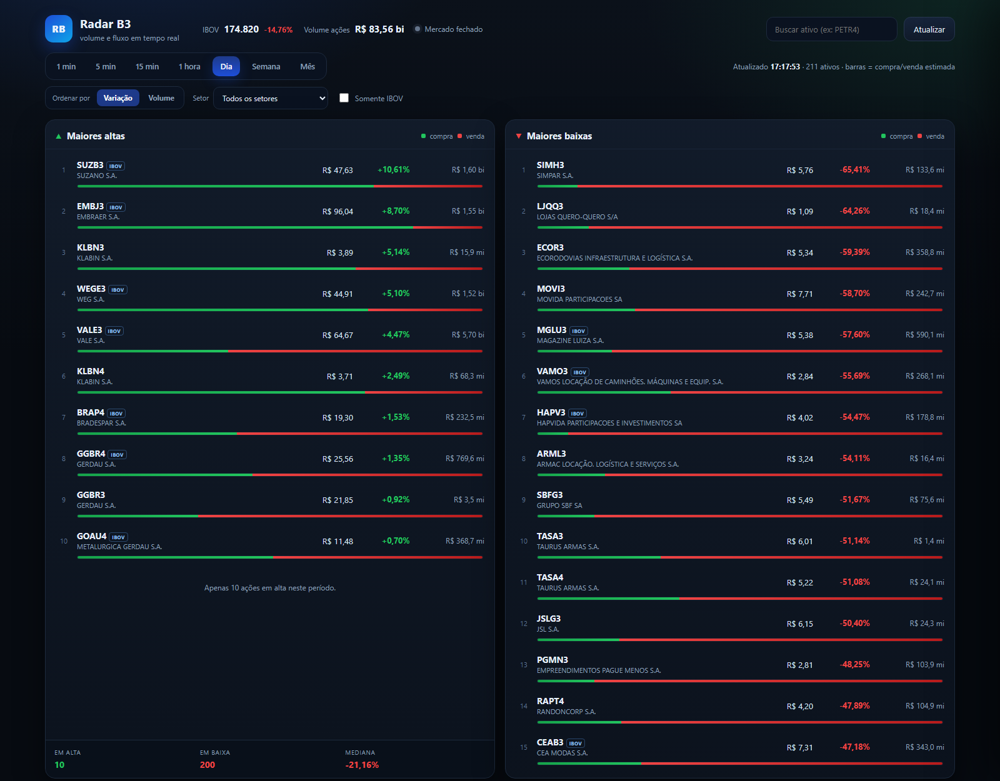
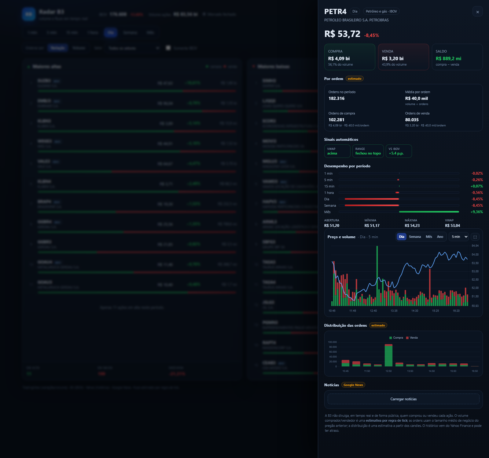

# Radar B3

Painel em tempo real e análise de liquidez para **ações da B3**, usando apenas **dados públicos** e
sem conexão com home broker.

[](https://github.com/edgar-lfsi/radar-b3)



## O que tem aqui

- `dashboard/` + `run_dashboard.py` — **painel em tempo real** (altas, baixas, volume compra/venda).
- `relatorio_B3_2026-10-26.md` — relatório de análise (snapshot de 26/10/2026 + sessão de 23/10/2026).
- `output/` — tabelas em CSV usadas no relatório.
- `data/raw/` — arquivos brutos baixados da B3 (não versionados; o script baixa de novo).
- `scripts/` — coleta, análise e geração do relatório.

## Painel em tempo real

Clique em **`painel.bat`** (ou rode `python run_dashboard.py`) e abra <http://127.0.0.1:8055>.

### Ranking

- Períodos: **1 min, 5 min, 15 min, 1 hora, dia, semana e mês**.
- **15 maiores altas** e **15 maiores baixas** do período.
- Barra verde/vermelha com o **volume comprado vs vendido estimado** em cada linha.
- **Ordenação** por variação ou por volume.
- **Filtro por setor** e **somente ações do IBOV**.
- Amplitude do mercado (altas, baixas e mediana) e volume somado das ações.

### Detalhe da ação

Ao clicar em uma linha:

- volume comprado, vendido e saldo;
- ordens estimadas de compra e venda e **média por ordem**;
- **sinais automáticos** (VWAP, range, volume relativo, fluxo e desempenho vs IBOV);
- desempenho em todos os períodos;
- abertura, mínima, máxima e VWAP;
- **gráfico de preço e volume** com períodos **Dia, Semana, Mês e Ano** e granularidade
  (minutos, horas, dias ou semanas);
- **gráfico de distribuição das ordens estimadas** ao longo do período;
- **notícias** da empresa, carregadas ao clique (Google News);
- botão de **tela cheia** no gráfico.



### Atualização

O painel atualiza a cada **15s**. O servidor guarda snapshots a cada 10s para estimar o fluxo
comprador/vendedor por regra de tick.

## Como rodar

```powershell
python -m pip install -r requirements.txt
python run_dashboard.py
```

Para gerar o relatório novamente:

```powershell
python scripts/collect_b3.py 2026-09-01 2026-10-26
python scripts/fetch_live.py
python scripts/analyze_b3.py
python scripts/build_report.py
```

> O relatório é um artefato do snapshot de 26/10/2026. Os scripts de análise exigem os arquivos
> brutos da B3 em `data/raw/` (não versionados).

## Fontes

| Dado | Fonte |
|---|---|
| Ranking, variações e volume | Scanner público do TradingView |
| Ibovespa | API de cotações da B3 |
| Histórico de preços | Yahoo Finance (fallback: brapi.dev) |
| Notícias | Google News RSS |
| Negócios por ativo (relatório) | Arquivos abertos da B3 (`TradeInformationConsolidated`) |
| Carteira teórica do Ibovespa | Boletim Diário do Mercado (B3) |
| Fluxo por categoria | B3, compilado por fontes públicas, D+2 |

## Limitações importantes

1. **Não existe "volume de compra" separado de "volume de venda"**: toda negociação tem um comprador
   e um vendedor. O painel mede preço, volume e uma **estimativa** de fluxo por regra de tick.
2. **A B3 não identifica CPF/CNPJ** de compradores e vendedores e não divulga o agressor em tempo real
   de forma pública. O número de ordens é estimado pelo tamanho médio de negócio do pregão anterior.
3. **O histórico pode ter atraso** e depende de fontes gratuitas (Yahoo/brapi). O primeiro carregamento
   de um período pode levar de segundos a ~40s; depois fica em cache por 6h.
4. **Não é recomendação de investimento.**

## Segurança e privacidade

- Nenhuma chave de API, token, senha ou dado pessoal é necessária ou armazenada.
- O painel roda localmente em `127.0.0.1` e **não se conecta ao home broker**.
- As consultas usam apenas endpoints públicos (TradingView, B3, Yahoo, Google News, brapi).
- `data/raw/` e `data/cache/` não são versionados.

## Licença

MIT — veja `LICENSE`.
